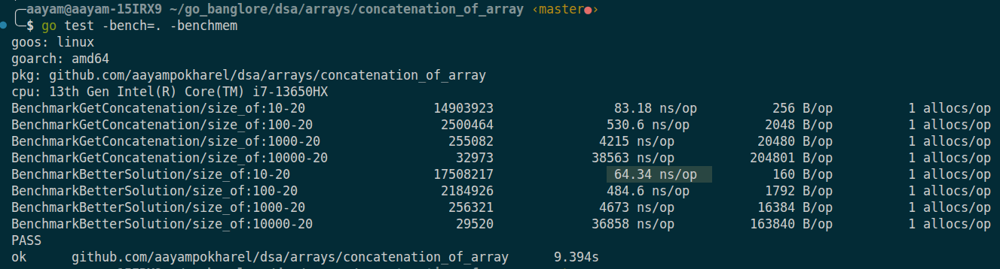

### My Approach

Used Go's built-in append() function to concatenate
the slice with itself.

`append(nums, nums...)` expands nums into individual
elements and appends them to the original slice.

### Time Complexity: O(n)

Appending n elements requires copying n elements
into the resulting slice.

Even if a new underlying array is allocated,
the total copying work is proportional to n.

### Space Complexity: O(n)

The resulting slice contains 2n elements.

If the original slice has insufficient capacity,
Go allocates a new underlying array.

### Go Concepts Learned

- append()
- Variadic expansion (...)
- Slice header (pointer, length, capacity)
- Underlying array
- Slice capacity and allocation
- Amortized complexity
- slice's invalidity for == or != with other slices comparision.

---

### Better Solution: (based on benchmark)



```go
func getConcatenation(nums []int) []int {
    n := len(nums)
    ans := make([]int, 2*n)
    for i := 0; i < n; i++ {
        ans[i] = nums[i]
        ans[i+n] = nums[i]
    }
    return ans
}
```
the benchmark above shows how the bettersolution is only slightly slower for 1000 elements than my solution, but beats append in other 3 sizes of 10,100,10k sizes. 


---

