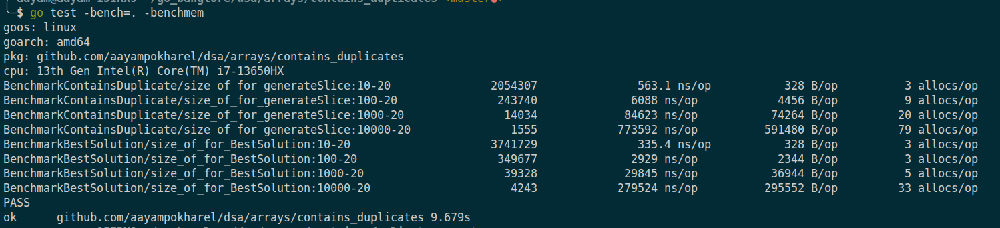

### Comparing My Two Approaches: `map[int]int` vs. `map[int]struct{}`

Both methods feature early exits and $O(n)$ time complexity, meaning performance differences are minor for normal inputs. However, analyzing why my `map[int]int` approach is *slightly* suboptimal reveals key design principles in Go.

---

### Why My `map[int]int` Method is Slightly Worse

1. **Semantic Mismatch (Counting vs. Presence):**
Using `m[val]++` tracks frequencies. But for a duplicate check, I do not care *how many times* a number appears—I only care **if** it has appeared at least once. Counting requires extra mental overhead and misrepresents the true intent of the code.
2. **Unnecessary Memory Footprint:**
In `map[int]int`, every entry stores an integer value (8 bytes on 64-bit systems) alongside the key. While small, it allocates memory for data I never use.

---

### Why `BestSolution` (`map[int]struct{}`) is Better

1. **True "Set" Semantics:**
Since Go lacks a native `Set` data structure, `map[int]struct{}` is the idiomatic pattern for tracking uniqueness. It clearly signals to anyone reading the code that this map functions purely as a presence tracker.
2. **Zero-Byte Values:**
An empty struct (`struct{}`) takes up **0 bytes** of memory for the value. It eliminates the minor memory overhead of storing integers.

---

### What I Can Learn Here

* **Match the Data Structure to the Problem:** If the goal is checking existence, model it as presence (`map[K]struct{}`), not counting (`map[K]int`).
* **Intent Clarity:** Code becomes easier to maintain when the data types match the exact question being asked. Even though both solutions solve the problem, `map[int]struct{}` expresses uniqueness more accurately.

