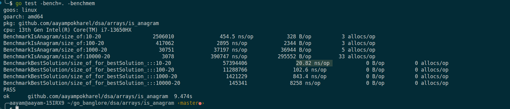

The Optimized Array Approach (Assuming ASCII / for Lowercase Letters)

## Why the Array Approach is Faster
### 1. Zero Heap Allocations (0 B/op, 0 allocs/op):
Maps require dynamic memory allocation on the heap. A fixed array lives entirely on the stack, which avoids allocation costs and reduces garbage collection pressure.

### 2. Direct Indexing vs. Hashing:
Accessing an array via s[i] - 'a' uses direct memory offsets instead of calculating hash values for map keys, speeding up lookups.

### 3. Single-Pass Increment/Decrement:
Incrementing counts for s and decrementing for t simultaneously in a single loop reduces total iterations.

