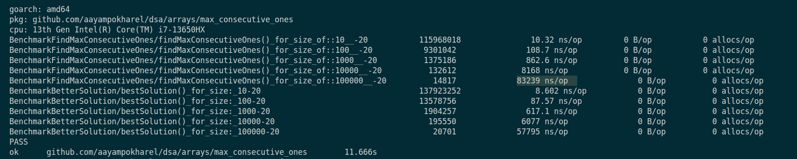

### Why `BestSolution` is Better Than My Initial Approach

* **Idiomatic Go:** Using `for _, val := range nums` is cleaner and more standard in Go than manually tracking slice indices.
* **No Nested Loops or Index Jumping:** My first solution relies on an inner loop and manually mutates the outer loop counter (`key = i`). Skipping indices like that makes the flow harder to read and easier to break.
* **Simpler State Management:** Instead of counting streaks inside a nested block, `BestSolution` uses a simple running tally—incrementing `currentCount` on `1`s and immediately resetting it to `0` on `0`s.
* **Cleaner Logic:** Both run in $O(n)$ time and $O(1)$ space, but `BestSolution` achieves it with half the nesting and zero manual index manipulation.

