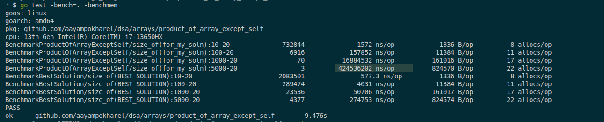

# Simple Solution:
 multiply all get the value and store it as fixed value. 
 for each item of the array, divide that total by that number.

 ---

 
 O(n²) solution becomes dramatically slower as input size grows, while the prefix/suffix solution scales linearly.