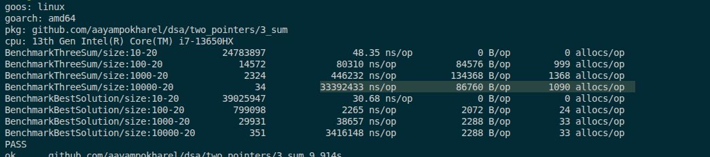

When an array is sorted, use that ordering to prevent duplicate results during generation rather than removing duplicates afterward(i.e. dont try making removal of duplicates as separate process as much as possible in sorted array questions)

