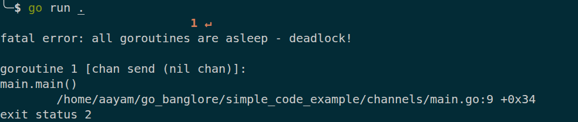

nilCh <- 1 
triggers first and causes a deadlock (a fatal runtime error), not a panic, so recover() will not catch it in main.Code is below: 


```go
func main() {
	var nilCh chan int
	var closedCh chan int = make(chan int)
	close(closedCh)
	var workingCh chan int = make(chan int)

	nilCh <- 1
	closedCh <- 1
	workingCh <- 1
}
```

## output: 



--
# IF I SEND TO CLOSED CHANNEL: 

```go
func main() {
	defer func() {
		if r := recover(); r != nil {
			fmt.Printf("panic:%v", r)
		}
	}()
	var closedCh chan int = make(chan int)
	close(closedCh)
	closedCh <- 1
}
```
##  OUTPUT: 

```bash
╰─$ go run . 
panic:send on closed channel% 
```

---

```go

func fastAPI(ch chan<- int) {
	time.Sleep(time.Millisecond * 1)
	ch <- 1
}
func slowAPI(ch chan<- int) {
	time.Sleep(time.Millisecond * 100)
	ch <- 100
}
func main() {
	var ch chan int = make(chan int)
	for range 100 {

		go fastAPI(ch)
		go slowAPI(ch)
		fmt.Println(<-ch, "no. of go routines", runtime.NumGoroutine())
	}

}
```

>[!important] the solution here would be to: fan-in pattern: using waitgroups here to know if all sending channels have sent their stuffs or not, and then close the channel; while in receiving side: I simply use the for...range loop over it. 


---

# Race condition: 

```go

func sendInCh(wg *sync.WaitGroup, ch chan<- int, val int) {
	defer wg.Done()
	ch <- val
}

func closeChannel(wg *sync.WaitGroup, ch chan int) {
	wg.Wait()
	close(ch)

}
func main() {
	var ch chan int = make(chan int)
	var wg sync.WaitGroup = sync.WaitGroup{}
	go func() {
		for channelVal := range ch {
			fmt.Println(channelVal)
		}
	}()

	for key := range 100 {
		if key%2 == 0 {
			wg.Add(1)
			go sendInCh(&wg, ch, key)
			wg.Wait()
		}

	}
	go closeChannel(&wg, ch)

	fmt.Println("thankyou")
}
```
here, above 98 sometimes prints sometimes it doesnot. 
>[!alert] becz: at anytime, because of `wg.Wait()` only 1 sender's goroutine is active.Total:main+1 sender+1 of for---range, total 3 goroutines. 

Handshake on ch <- 98: The sender goroutine sends 98, and the receiver goroutine accepts 98 into channelVal inside for channelVal := range ch.

Scheduler interleaving: Right after channelVal receives 98—before the receiver goroutine actually executes fmt.Println(98)—the Go scheduler can switch execution back to the sender or main.

wg.Done() unblocks wg.Wait(): The sender finishes ch <- 98 and runs defer wg.Done(), releasing wg.Wait() inside the loop.

Loop finishes and main exits: key finishes 99, go closeChannel(&wg, ch) is launched, and main reaches fmt.Println("thankyou") and returns.

Process ends mid-print: Returning from main tears down the whole Go process immediately, so the receiver goroutine may never get scheduled to finish fmt.Println(98) (or flush stdout).